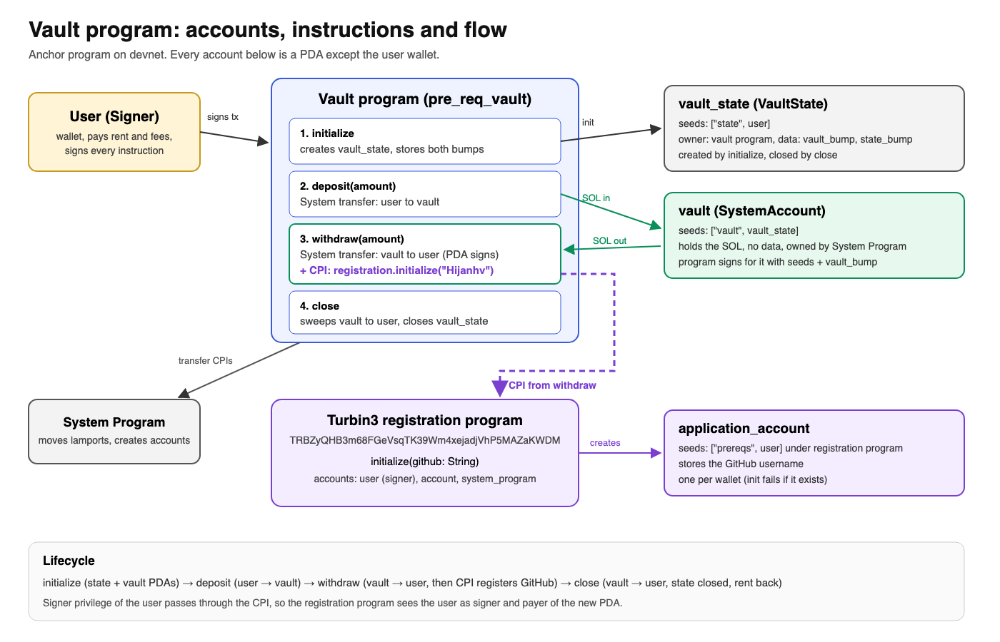

# pre-req-vault

Turbin3 Q4 2026 Builders Cohort prerequisite, Part 1.

An Anchor vault program with four instructions: `initialize`, `deposit`, `withdraw` and `close`. I extended `withdraw` with a CPI to the Turbin3 registration program (`initialize`), which records my GitHub username, `Hijanhv`.



## Devnet

| What | Address |
|---|---|
| Vault program (my deploy) | [`73YEzwcbwhygse5vFX7LH1spxMngPwugWk5U3Ye8D981`](https://explorer.solana.com/address/73YEzwcbwhygse5vFX7LH1spxMngPwugWk5U3Ye8D981?cluster=devnet) |
| Registration account, PDA `["prereqs", user]` | [`49M2kvPcWHYhS11vLowwPQ8bRchZyKXKExTpJMzGJPhA`](https://explorer.solana.com/address/49M2kvPcWHYhS11vLowwPQ8bRchZyKXKExTpJMzGJPhA?cluster=devnet) |
| Withdraw transaction with the CPI | [`4nt4gtER...dZ`](https://explorer.solana.com/tx/4nt4gtEREfB1xVMUUb736wt3dfp1efYo1ScuQg3jCiXsJQUmVtCZmEhNpoTh5rhnK1mXWmnMdCcsxLZdtPFqkAdZ?cluster=devnet) |

The withdraw transaction logs show my vault program invoking the registration program (`TRBZyQHB3m68FGeVsqTK39Wm4xejadjVhP5MAZaKWDM`) at depth 2.

## Run

```
anchor build
solana program deploy target/deploy/pre_req_vault.so --program-id target/deploy/pre_req_vault-keypair.json
anchor test --skip-build --skip-deploy
```

I lowered the test amounts to a 0.2 SOL deposit and 0.1 SOL withdraw (from 1 and 0.5) because the devnet faucet was rate limited and the deploy left too little SOL for a 1 SOL deposit.
